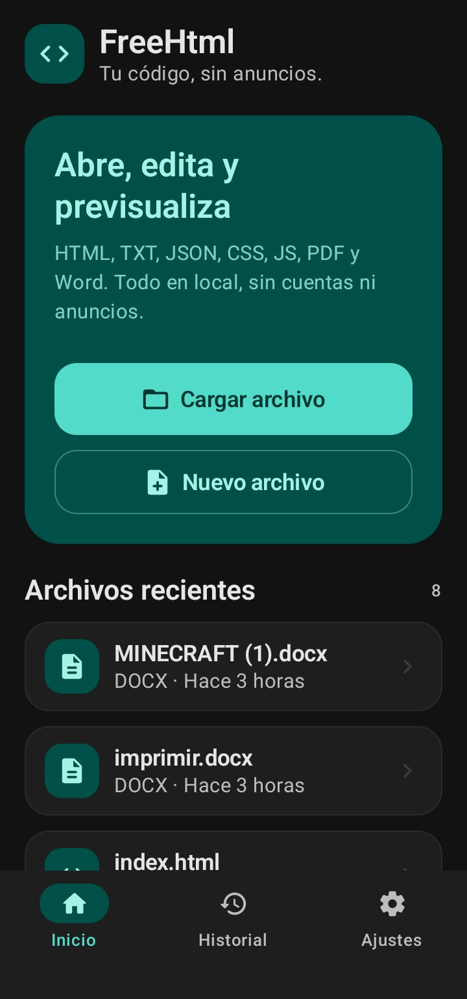
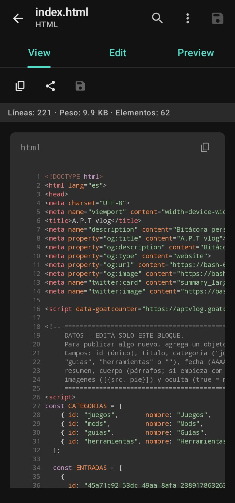
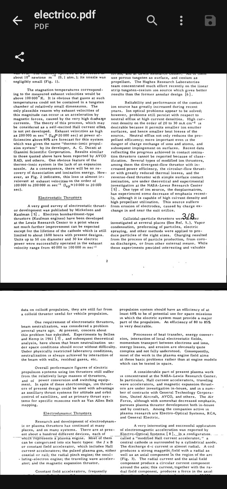
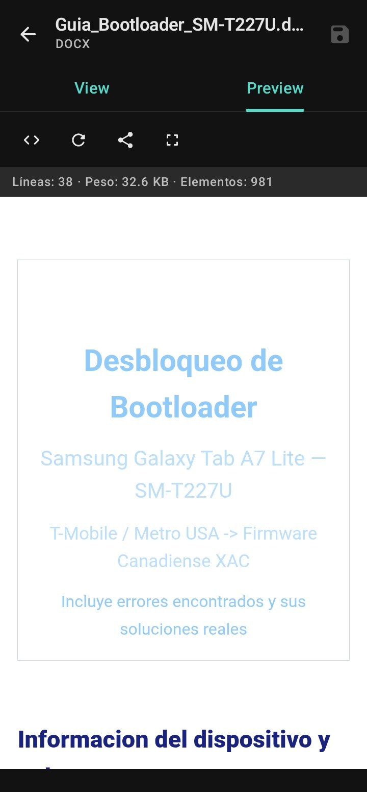
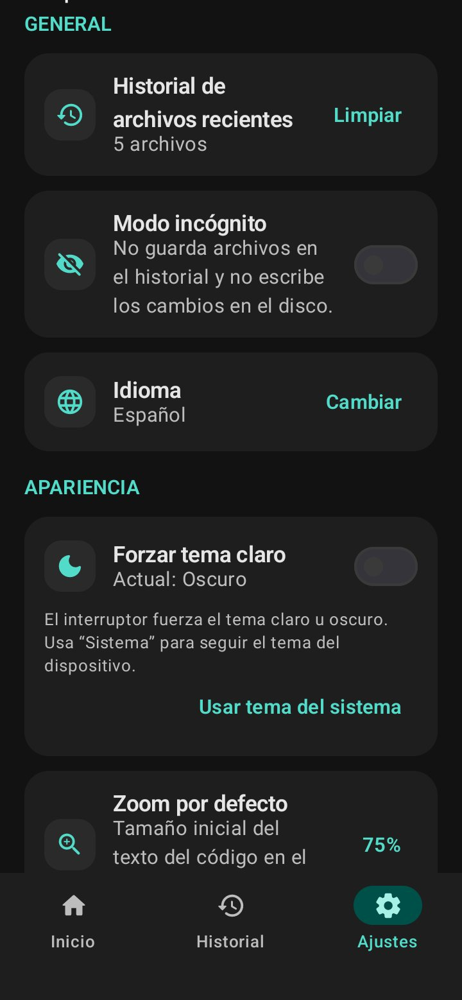

# FreeHtml

**Tu código, sin anuncios.**

FreeHtml es un visor y editor de archivos completamente gratuito, libre y sin anuncios para Android. Todo funciona en local: sin cuentas, sin rastreo y sin conexión a internet.

<p align="center">
  
  
  
</p>

## Capturas

| Inicio | Editor | PDF | Word | Ajustes |
| --- | --- | --- | --- | --- |
|  |  |  |  |  |

## Características

- **Editor de código** con resaltado de sintaxis para HTML, TXT, JSON, CSS y JS.
- **Pestañas** — Ver (código resaltado), Editar y Vista previa del render.
- **Vista previa en vivo** con soporte de CSS/JS internos y externos, imágenes y `localStorage`.
- **Visor de PDF** con botón para compartir el archivo.
- **Visor de Word (.docx)** que respeta títulos, listas, tablas, enlaces, imágenes y formato de texto.
- **Búsqueda en el código** con contador de resultados y salto entre coincidencias.
- **Zoom del editor** configurable (50 % – 300 %), con valor por defecto en Ajustes.
- **Modo incógnito**: abre archivos sin dejarlos en el historial y sin escribir cambios en el disco.
- **Historial** de archivos recientes con borrado selectivo.
- **Modo oscuro / claro / sistema**, persistente.
- **Idiomas**: Español, Inglés, Francés, Portugués (o sigue el idioma del sistema).
- **100 % local**: los archivos nunca salen del dispositivo.

## Descarga

Descarga el APK más reciente desde la sección [Releases](https://github.com/bash-666/FreeHtml/releases) del repositorio.

Requisitos: Android 9.0 (API 28) o superior.

## Compilar desde el código fuente

```bash
git clone https://github.com/bash-666/FreeHtml.git
cd FreeHtml
./gradlew :app:assembleDebug
```

El APK se genera en `app/build/outputs/apk/debug/`.

> El proyecto usa R8 en release (`isMinifyEnabled`); para compilar una release firmada necesitas tu propio `keystore` (ver `app/build.gradle.kts`).

## Estructura del proyecto

```
app/src/main/java/com/freehtml/app/
├── data/          # Preferencias (DataStore) y modelos
├── ui/
│   ├── editor/    # Editor, visor PDF, vista previa (WebView)
│   ├── home/      # Pantalla principal e historial
│   └── settings/  # Ajustes
└── util/          # Conversión DOCX→HTML, resolución de recursos HTML
```

## Licencia

Copyright (C) 2026 bash-666

Este programa es software libre: puedes redistribuirlo y/o modificarlo bajo los términos de la **GNU General Public License** publicada por la Free Software Foundation, en su versión 3 (o, si lo prefieres, cualquier versión posterior).

Consulta el archivo [LICENSE](LICENSE) para ver el texto completo de la licencia.
